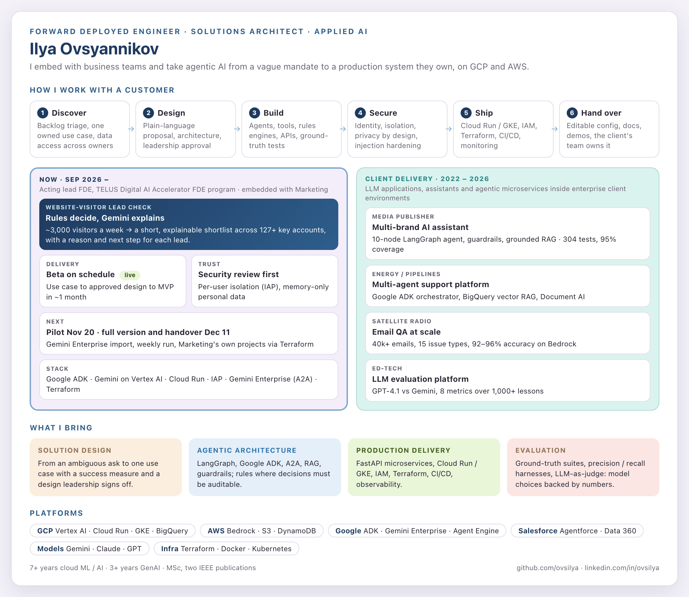

<picture>
  <source media="(prefers-color-scheme: dark)" srcset="assets/profile-dark.png">
  
</picture>

I embed with business teams and take agentic AI from discovery to a production system they own. Currently acting lead Forward Deployed Engineer in TELUS Digital's AI Accelerator FDE program.

## Featured projects

*Sanitized versions of production systems from client and internal engagements. All client identifiers, data and credentials are removed.*

| Project | What it is | Stack |
|---|---|---|
| [website-visitor-lead-check-agent](https://github.com/ovsilya/website-visitor-lead-check-agent) | **Current FDE engagement.** An agent that turns ~3,000 identified website visitors a week into a short, explainable shortlist across 127+ key accounts: rules decide and write each reason and next step, Gemini explains. Includes per-user isolation from verified IAP tokens, memory-only personal data, 13 business-editable rule lists, and hub-and-spoke target architecture diagrams. | Google ADK · Gemini (Vertex AI) · Cloud Run · IAP · pandas · pytest |
| [ai-assistant-langgraph-backend](https://github.com/ovsilya/ai-assistant-langgraph-backend) | Conversational AI backend for a major media publisher: a per-request LangGraph agent with LLM-as-judge guardrails, intent routing, grounded RAG answers with article recommendations, multi-brand personas and a GDPR deletion worker. 304 tests, 95% coverage. | LangGraph · FastAPI · Claude / Gemini · DynamoDB · Redis · Kubernetes |
| [multi-agent-support-platform](https://github.com/ovsilya/multi-agent-support-platform) | A Slack-native multi-agent support platform for industrial pipeline operations, plus a Document AI pipeline that fills engineering workbooks from RFI documents, evaluated against ground truth. | Google ADK · Gemini · Cloud Run · BigQuery vector RAG · Document AI |
| [email-qa-llm-pipeline](https://github.com/ovsilya/email-qa-llm-pipeline) | An LLM email-QA system that scans 40k+ marketing emails for 15 issue types, with parallel Bedrock workers, checkpoint/resume, versioned prompts and a precision/recall evaluation harness. | AWS Bedrock (Claude) · S3 · pandas · boto3 |
| [llm-sentence-generation-eval](https://github.com/ovsilya/llm-sentence-generation-eval) | A dual-LLM benchmarking platform (GPT-4.1 vs Gemini 2.5) with parallel generation over CEFR-levelled data, token and cost accounting including thinking tokens, and an 8-metric NLP evaluation harness. | OpenAI · Vertex AI / Gemini · scikit-learn · NLTK |

**More:**
- [AI_news](https://github.com/ovsilya/AI_news): a personal daily AI brief that collects, ranks and summarises news with Gemini.
- [blu_baar_chatbot](https://github.com/ovsilya/blu_baar_chatbot): a bilingual chatbot API on Cloud Run with Cloud Build CI/CD.
- [aml-assistant](https://github.com/ovsilya/aml-assistant): a compliance RAG chatbot.
- [CBC-news-RAG](https://github.com/ovsilya/CBC-news-RAG): RAG over news articles and editorial guidelines.
- [receipt_scanner](https://github.com/ovsilya/receipt_scanner): a serverless Document AI workflow on GCP.
- [respondelligent_cpu](https://github.com/ovsilya/respondelligent_cpu): mBART fine-tuning and deployment.
- [code_portfolio_examples](https://github.com/ovsilya/code_portfolio_examples): classic ML and SQL samples.

## Toolbox

### AI and agents
- **Agent frameworks:** Google ADK (agents, tools, plugins, A2A) · LangGraph · LangChain
- **Models:** Gemini (Vertex AI) · Claude (AWS Bedrock) · OpenAI GPT · LiteLLM gateway
- **Patterns:** RAG · guardrails · intent routing · rules + LLM hybrids · prompt engineering
- **Evaluation:** ground-truth test suites · precision / recall harnesses · LLM-as-judge

### Enterprise agent platforms
- **Google:** Gemini Enterprise · Vertex AI Agent Engine
- **Salesforce:** Agentforce (Agent Builder, Prompt Builder, Flow / Apex actions) · Data 360 · Einstein Trust Layer · Testing Center

### Cloud and architecture
- **GCP:** Cloud Run · GKE · Vertex AI · BigQuery · Document AI · Cloud Build · Artifact Registry
- **AWS:** Bedrock · S3 · DynamoDB · SageMaker
- **Infrastructure:** Terraform · CI/CD · Workload Identity Federation · hub-and-spoke projects

### Security and data governance
- **Access:** Identity-Aware Proxy (signed JWTs) · IAM · least-privilege service accounts
- **Data:** privacy by design · memory-only personal data · data-enablement reviews
- **LLM safety:** prompt-injection hardening · content security policy

### Engineering
- **Languages and APIs:** Python · FastAPI · SQL · JavaScript
- **Data:** pandas · scikit-learn · Redis / Valkey · DynamoDB · BigQuery
- **Ops:** Docker · Kubernetes · pytest · Datadog · Sentry · OpenTelemetry

### Delivery
- **Discovery:** workshops · use-case prioritisation · data-access mapping
- **Design:** solution proposals · architecture decision records · demos for leadership
- **Execution:** stakeholder management · Jira · Gantt planning · weekly status reporting

## Contact

[LinkedIn](https://www.linkedin.com/in/ovsilya) · [ovsyannikovilyavl@gmail.com](mailto:ovsyannikovilyavl@gmail.com)

*MSc; two IEEE publications on deep learning for computer vision.*
